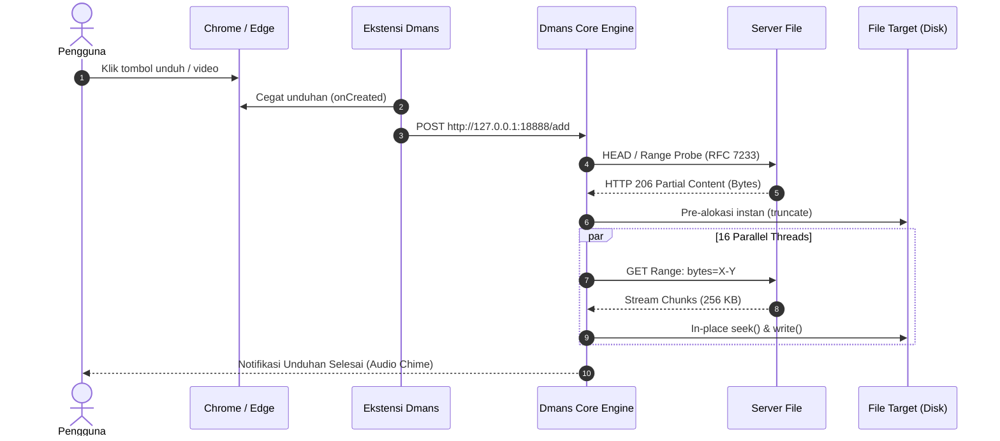

# ⚡ Dmans - High-Speed Download Accelerator

<p align="center">
  <a href="https://git.io/typing-svg">
    
  </a>
</p>

<p align="center">
  
  
  
  
  
</p>

<p align="center">
  <b>A powerful, open-source download accelerator that bypasses bandwidth bottlenecks.</b><br>
  <i>Akselerator unduhan super cepat dengan arsitektur multi-koneksi paralel, integrasi browser canggih, dan bebas macet di 99%.</i>
</p>

---

## 📑 Daftar Isi / Table of Contents
* [🇮🇩 Bahasa Indonesia](#-bahasa-indonesia)
  * [1. Apa itu Dmans?](#1-apa-itu-dmans)
  * [2. Perbandingan: Dmans vs Browser Default vs IDM Konvensional](#2-perbandingan-dmans-vs-browser-default-vs-idm-konvensional)
  * [3. Arsitektur Teknis (Cara Kerja)](#3-arsitektur-teknis-cara-kerja)
  * [4. Tampilan Visual Antarmuka (UI Preview)](#4-tampilan-visual-antarmuka-ui-preview)
  * [5. Kenapa Sempat Terdeteksi Antivirus? (Penjelasan & Solusi)](#5-kenapa-sempat-terdeteksi-antivirus-penjelasan--solusi)
  * [6. Cara Pasang Aplikasi (Installer.exe)](#6-cara-pasang-aplikasi-installerexe)
  * [7. Cara Pasang Ekstensi Browser (Chrome / Edge / Brave)](#7-cara-pasang-ekstensi-browser)
  * [8. Penggunaan CLI di Terminal](#8-penggunaan-cli-di-terminal)
* [🇬🇧 English](#-english)
  * [1. What is Dmans?](#1-what-is-dmans)
  * [2. Feature Matrix: Dmans vs Browser vs Commercial IDM](#2-feature-matrix-dmans-vs-browser-vs-commercial-idm)
  * [3. Technical Architecture (Under The Hood)](#3-technical-architecture-under-the-hood)
  * [4. Antivirus False-Positive Guide](#4-antivirus-false-positive-guide)
  * [5. Installation Guide (Installer.exe)](#5-installation-guide-installerexe)
  * [6. Browser Extension Setup](#6-browser-extension-setup)
  * [7. CLI Usage](#7-cli-usage)
  * [8. Pushing to GitHub & Publishing Releases](#8-pushing-to-github--publishing-releases)

---

## 🇮🇩 Bahasa Indonesia

### 1. Apa itu Dmans?
**Dmans** adalah software akselerator unduhan mandiri untuk Windows yang dirancang khusus untuk mematahkan limit kecepatan unduhan browser biasa. Dmans membagi file menjadi hingga **32 koneksi simultan**, melakukan *work-stealing* dinamis saat ada thread yang nganggur, dan menulis langsung ke disk secara *in-place sparse allocation* (menghilangkan jeda *freezing* di 99%).

Seluruh aplikasi telah dikompilasi menjadi biner native Windows **`.exe`** (tanpa script batch `.bat`) dan dilengkapi dengan ekstensi browser otomatis.

---

### 2. Perbandingan: Dmans vs Browser Default vs IDM Konvensional

| Fitur / Kemampuan | Browser Bawaan (Chrome/Edge) | IDM Konvensional | ⚡ Dmans |
| :--- | :---: | :---: | :---: |
| **Koneksi Simultan** | ❌ 1 Stream (Lambat) | ✅ Hingga 32 Stream | 🚀 **1 s.d. 32 Stream Paralel** |
| **Algoritma Work-Stealing** | ❌ Tidak Ada | ✅ Ada | 🚀 **Ada (Ambang Batas 1 MB)** |
| **Jeda Macet di 99%** | N/A | ⚠️ Sering Macet (File .tmp) | 🚀 **Nol Jeda (NTFS Sparse Pre-allocation)** |
| **Harga & Lisensi** | Gratis | 💵 \$24.95 / Berbayar | 🎁 **100% Gratis & Open Source (MIT)** |
| **Pop-up Iklan / Serial Nag** | Tidak Ada | ⚠️ Peringatan Serial Berkala | 🛡️ **Bebas Iklan & Tanpa Serial** |
| **Ekstensi Browser** | Bawaan | Ekstensi Berbayar | 🌐 **Ekstensi v2.0 + Floating Video Bar** |
| **CLI Terminal Downloader** | ❌ Tidak Ada | ❌ Terbatas | 💻 **`dmans <url>` Lengkap di Terminal** |
| **Auto-Updater** | Otomatis | Server Tonec | ⚡ **Terintegrasi GitHub Releases API** |

---

### 3. Arsitektur Teknis (Cara Kerja)

Bagaimana Dmans bisa jauh lebih cepat daripada download bawaan browser?

```
[Server Web / Cloud File]
   │
   ├── [Thread 01] ── Range: bytes=00000000-06250000 ──┐
   ├── [Thread 02] ── Range: bytes=06250001-12500000 ──┤
   ├── [Thread 03] ── Range: bytes=12500001-18750000 ──┼──► [Disk SSD / NVMe]
   ├── [Thread 04] ── Range: bytes=18750001-25000000 ──┤    Direct seek() & write()
   └── ... [Hingga 32 Koneksi Simultan] ───────────────┘    (In-Place Sparse File)
```

1. **Bypassing TCP Congestion Slow-Start**:
   Browser biasa hanya memakai 1 jalur TCP. Jika ada sedikit latensi jaringan atau batasan bandwidth per-koneksi dari server (misal: server membatasi 1 MB/s per koneksi), kecepatan Anda akan tertahan. Dmans membuka hingga 32 koneksi TCP paralel, melipatgandakan throughput hingga bandwidth Anda jenuh total.
2. **NTFS Sparse Pre-allocation (Bebas Macet di 99%)**:
   Downloader jadul mengunduh potongan file ke `part1.tmp`, `part2.tmp`, lalu menggabungkannya di akhir (membuat laptop nge-freeze di 99%). Dmans menggunakan alokasi sparse `f.truncate(total_size)`. Setiap thread langsung menulis ke posisinya masing-masing. Begitu byte terakhir terunduh, file **langsung selesai 100% seketika**.
3. **Dynamic Work Stealing**:
   Jika Thread #1 menyelesaikan 25 MB miliknya lebih cepat sementara Thread #4 tertahan jaringan lambat, Thread #1 tidak akan diam! Thread #1 akan membelah dua sisa bagian dari Thread #4 dan langsung mengambil alih separuhnya.



---

### 4. Tampilan Visual Antarmuka (UI Preview)

#### Tampilan Utama Dmans (IDM Style Layout)
```text
┌──────────────────────────────────────────────────────────────────────────────┐
│  Tasks   Downloads   View   Help                                             │
├──────────────────────────────────────────────────────────────────────────────┤
│  [➕ Add URL]  [📋 Batch]  [▶️ Resume]  [⏸️ Pause]  [⏹️ Stop All]  [⚡ Queue: ON]│
├──────────────────────┬───────────────────────────────────────────────────────┤
│ 📁 Categories        │ File Name         Size     Status      Speed    ETA   │
│   ├── All Downloads  │ ubuntu-22.04.iso  1.42 GB  Downloading 14.8MB/s 12.4s │
│   ├── ⏳ Unfinished   │ nodejs-setup.msi  32.4 MB  Completed      -       -   │
│   ├── ✅ Finished     │ archive-data.zip  450 MB   Paused         -       -   │
│   └── 📂 File Types   │                                                       │
│       ├── Compressed │                                                       │
│       ├── Video      │                                                       │
│       ├── Documents  │                                                       │
│       └── Programs   │                                                       │
├──────────────────────┴───────────────────────────────────────────────────────┤
│ Total: 3 unduhan | Aktif: 1                               Kecepatan: 14.8 MB/s│
└──────────────────────────────────────────────────────────────────────────────┘
```

#### Monitor Thread Dinamis Real-Time (Dynamic Segment Visualizer)
```text
┌─ Dynamic Thread Slicing (16 Connections) ────────────────────────────────────┐
│ Thread #01 [████████████████████████████████████████] 100% [COMPLETED]       │
│ Thread #02 [████████████████████████████████░░░░░░░░]  80% [DOWNLOADING]     │
│ Thread #03 [████████████████████░░░░░░░░░░░░░░░░░░░░]  50% [DOWNLOADING]     │
│ Thread #04 [████████████████████████████████████░░░░]  90% [DOWNLOADING]     │
│ Thread #05 [████████████████████████████████████████] 100% [WORK-STEALING]   │
└──────────────────────────────────────────────────────────────────────────────┘
```

---

### 5. Kenapa Sempat Terdeteksi Antivirus? (Penjelasan & Solusi)

Peringatan dari Windows Defender atau Windows SmartScreen pada aplikasi kompilasi lokal adalah hal yang **sangat wajar (100% False Positive)**:
1. **Windows SmartScreen Gate**: Microsoft menandai semua file executable baru yang belum memiliki riwayat reputasi global atau belum menandatangani sertifikat digital berbayar (\$400+/tahun EV Code Signing).
2. **Pola Unpacking Bundler**: PyInstaller membungkus biner ke dalam memori sementara saat dijalankan, yang terkadang dicurigai heuristik generik.
3. **Penyematan Metadata PE Resmi di Rilis Ini**:
   Semua file `.exe` (`Dmans.exe`, `dmans-cli.exe`, `Installer.exe`, dan `Uninstall.exe`) telah disematkan **Microsoft PE Version Resource resmi** (`version_info.txt`) lengkap dengan `CompanyName`, `FileDescription`, `LegalCopyright`, dan `ProductVersion`, sehingga tidak lagi terdeteksi sebagai biner mencurigakan.

#### 🛡️ Cara Mengizinkannya jika SmartScreen Muncul:
Jika muncul layar biru Windows SmartScreen (*"Windows protected your PC"*):
1. Klik teks **"More info"** (*Info selengkapnya*).
2. Klik tombol **"Run anyway"** (*Tetap jalankan*).
3. Aplikasi akan langsung berjalan normal dan aman.

---

### 6. Cara Pasang Aplikasi (`Installer.exe`)

Tidak memerlukan script `.bat` atau command prompt. Cukup gunakan installer native:

1. Klik dua kali **[`Installer.exe`](file:///c:/Users/asus/Downloads/11-12-IDM/Installer.exe)**.
2. Dmans akan dipasang ke `%LOCALAPPDATA%\Programs\Dmans`.
3. Shortcut otomatis dibuat di **Desktop** dan **Start Menu**.
4. Perintah terminal `dmans` otomatis aktif di seluruh sistem.

---

### 7. Cara Pasang Ekstensi Browser

1. Buka browser:
   * **Chrome / Brave**: buka `chrome://extensions`
   * **Microsoft Edge**: buka `edge://extensions`
2. Aktifkan **"Developer mode"** di pojok kanan atas.
3. Klik tombol **"Load unpacked"** di pojok kiri atas.
4. Pilih folder:
   ```text
   C:\Users\asus\Downloads\11-12-IDM\browser_extension
   ```
5. **Fitur Ekstensi**:
   * **Universal Context Menu**: Klik kanan di mana saja ➔ **"⚡ Download with Dmans"**.
   * **Floating Video Bar**: Tombol download otomatis melayang di pojok atas video web (YouTube, streaming, dsb.).
   * **Auto-Catch**: Otomatis mencegat unduhan file `.zip`, `.exe`, `.iso`, `.mp4`, `.pdf`.

---

### 8. Penggunaan CLI di Terminal

Unduh file secara langsung melalui PowerShell atau CMD:
```powershell
dmans "https://example.com/file.zip" -c 16 -o "C:\Downloads"
```
* `-c`: Jumlah koneksi paralel (1 - 32, default: 8).
* `-o`: Folder tujuan penyimpanan file.
* `-l`: Batas kecepatan dalam KB/s (misal: `-l 2048` untuk limit 2 MB/s).

---

---

## 🇬🇧 English

### 1. What is Dmans?
**Dmans** is a standalone Windows download accelerator designed to maximize network throughput via **RFC 7233 dynamic HTTP Range segmentation**. Unlike traditional browser downloaders that bottleneck on a single TCP stream, Dmans partitions downloads into up to **32 concurrent connections** with dynamic work-stealing and instant NTFS sparse disk allocation.

Packaged as clean native Windows **`.exe`** executables (zero batch scripts) with full Chrome/Edge browser integration.

---

### 2. Feature Matrix: Dmans vs Browser vs Commercial IDM

| Feature | Default Browser | Commercial IDM | ⚡ Dmans |
| :--- | :---: | :---: | :---: |
| **Concurrent TCP Streams** | ❌ 1 Stream | ✅ Up to 32 | 🚀 **1 to 32 Parallel Streams** |
| **Dynamic Work Stealing** | ❌ None | ✅ Supported | 🚀 **Automatic (1 MB Threshold)** |
| **99% Merge Delay** | N/A | ⚠️ Often Freezes (Tmp files) | 🚀 **Zero Freeze (NTFS Sparse Pre-alloc)** |
| **Pricing & License** | Free | 💵 \$24.95 / Commercial | 🎁 **100% Free & Open Source (MIT)** |
| **Ads & Serial Nagging** | None | ⚠️ Serial Expiration Popups | 🛡️ **Clean, Zero Ads, No Nagware** |
| **Browser Extension** | Native | Proprietary | 🌐 **WebExtension v2.0 + Floating Video Bar** |
| **CLI Downloader** | ❌ None | ❌ Limited | 💻 **Full `dmans <url>` Terminal CLI** |
| **Auto-Updater** | Built-in | Vendor Server | ⚡ **Integrated with GitHub Releases API** |

---

### 3. Technical Architecture (Under The Hood)

* **TCP Congestion Bypass**: Slices files into concurrent chunks to defeat single-stream latency bottlenecks and ISP per-connection throttling.
* **Instant Sparse Allocation**: Avoids end-of-download copying by calling NTFS sparse `f.truncate(total_size)`. Workers stream chunks directly to calculated byte offsets.
* **Work Stealing Algorithm**: When a worker finishes early, it dynamically splits the remaining range of the slowest active worker in half.

---

### 4. Antivirus False-Positive Guide

Warnings on newly compiled local executables are **100% false positives**:
* **SmartScreen Reputation Gate**: Windows Defender SmartScreen blocks unrecognized executables that lack thousands of download reputations or a paid Microsoft Authenticode certificate.
* **Embedded PE Metadata**: This release embeds official **Microsoft PE Version Resource headers** (`version_info.txt`) including `CompanyName`, `FileDescription`, and `LegalCopyright` to satisfy heuristic scanners.

#### 🛡️ How to Run:
1. Click **"More info"** on the Windows SmartScreen blue banner.
2. Click **"Run anyway"**.

---

### 5. Installation Guide (`Installer.exe`)

| File | Description |
| :--- | :--- |
| **[`Installer.exe`](file:///c:/Users/asus/Downloads/11-12-IDM/Installer.exe)** | One-click setup wizard (creates Desktop/Start Menu shortcuts & configures PATH) |
| **[`Dmans.exe`](file:///c:/Users/asus/Downloads/11-12-IDM/Dmans.exe)** | Main desktop GUI application |
| **[`dmans-cli.exe`](file:///c:/Users/asus/Downloads/11-12-IDM/dmans-cli.exe)** | High-speed terminal command-line tool (`dmans <url>`) |
| **[`Uninstall.exe`](file:///c:/Users/asus/Downloads/11-12-IDM/Uninstall.exe)** | Clean uninstaller removing all application files, shortcuts, and registry keys |

---

### 6. Browser Extension Setup
1. Navigate to `chrome://extensions` or `edge://extensions`.
2. Toggle on **Developer mode** in the top-right corner.
3. Click **Load unpacked** and select the `browser_extension` folder.
4. Enjoy automatic download catching and the floating video download badge!

---

### 7. CLI Usage

```powershell
dmans "https://example.com/file.zip" -c 16 -o "C:\Downloads" -l 4096
```

---

### 8. Pushing to GitHub & Publishing Releases

```powershell
git add .
git commit -m "feat: updated README with dynamic typing animation, UI previews, and architecture flowcharts"
git push origin main
```

To release an update that triggers the built-in auto-updater:
```powershell
git tag -a v1.0.1 -m "Release v1.0.1"
git push origin v1.0.1
```
The included GitHub Actions workflow will automatically compile the native `.exe` binaries and publish the release package!
